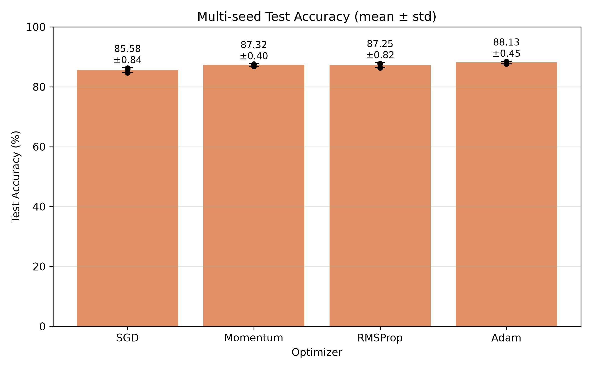
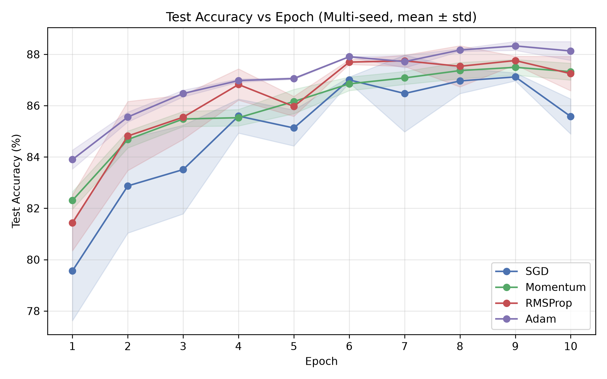

# Fashion-MNIST Optimizer Comparison

一个简洁的 PyTorch 实验项目，在 Fashion-MNIST 数据集上训练同一个 MLP 模型，比较四种常见优化器（SGD、Momentum、RMSProp、Adam）的性能差异，作为研究生《机器学习》课程实验。

## 项目简介

本项目通过三组递进的实验，系统比较四种优化器在 Fashion-MNIST 图像分类任务上的表现：

1. **Experiment 1（统一学习率）**：四个优化器使用相同学习率 `lr=0.001`，说明「同样的学习率并不意味着公平」——各优化器对学习率的敏感程度不同。
2. **Experiment 2（各优化器合理学习率）**：为各优化器设置经验上更合理的学习率，说明超参数调优后性能差距明显缩小。
3. **Experiment 3（多随机种子）**：用 3 个随机种子重复 Experiment 2，报告 `mean ± std`，验证结论的稳健性。

## 实验任务

- 在 Fashion-MNIST 上训练一个多层感知机（MLP）分类模型
- 比较 SGD、Momentum、RMSProp、Adam 四种优化器的收敛效果
- 记录并对比各优化器的测试准确率、训练 loss、训练时间与收敛速度

## 数据集

[Fashion-MNIST](https://github.com/zalandoresearch/fashion-mnist) 是一个服装图像分类数据集，包含 10 个类别（T 恤、裤子、鞋子、包等），共 70,000 张 28×28 的灰度图像（训练集 60,000 张，测试集 10,000 张），常被用作 MNIST 的替代基准。


## 模型结构

三层全连接网络（MLP）：

```
输入 (28×28 = 784)
  → Linear(784, 128) → ReLU
  → Linear(128, 64)  → ReLU
  → Linear(64, 10)
```

## 比较的优化器

| 优化器 | 学习率 | 说明 |
|--------|--------|------|
| SGD | 0.1 | 普通随机梯度下降 |
| Momentum | 0.01 | 带动量（momentum=0.9）的 SGD |
| RMSProp | 0.001 | 自适应学习率 |
| Adam | 0.001 | 结合动量与自适应学习率 |

## 实验设置

- 框架：PyTorch
- 损失函数：交叉熵损失（CrossEntropyLoss）
- 训练轮数：10 个 epoch
- 批大小：64
- 随机种子：Experiment 1/2 用 42；Experiment 3 用 42、123、2026
- 每个优化器都从相同模型初始化开始训练（受 seed 控制）
- DataLoader shuffle 通过 `torch.Generator` 受 seed 控制，保证各优化器在相同 seed 下得到相同 batch 顺序

## 主要结果（Experiment 3：多随机种子，mean ± std）

| 优化器 | 准确率 (mean ± std) | 最终 Loss (mean ± std) | 训练时间 (mean ± std) |
|--------|---------------------|------------------------|------------------------|
| SGD | 85.58% ± 0.84% | 0.2799 ± 0.0014 | 33.25 ± 0.14 |
| Momentum | 87.32% ± 0.40% | 0.2767 ± 0.0004 | 33.85 ± 0.24 |
| RMSProp | 87.25% ± 0.82% | 0.2459 ± 0.0007 | 34.63 ± 0.12 |
| Adam | 88.13% ± 0.45% | 0.2477 ± 0.0006 | 35.65 ± 0.13 |

> 具体数值见 `results/experiment3_multiseed_summary.csv`。

## 历史单次实验结果（Experiment 2）

| 优化器 | 学习率 | 准确率 | 训练时间(秒) | 最终 Loss |
|--------|--------|--------|--------------|-----------|
| SGD | 0.1 | 86.25% | 33.09 | 0.2791 |
| Momentum | 0.01 | 87.58% | 33.86 | 0.2763 |
| RMSProp | 0.001 | 87.73% | 34.20 | 0.2468 |
| Adam | 0.001 | 88.27% | 36.38 | 0.2481 |

> 具体数值见 `results/experiment2_tuned_lr.csv`。

## 结果图

### 训练 Loss 曲线


### 测试准确率柱状图


### 训练时间柱状图


### 多随机种子准确率（mean ± std）



### 测试准确率随 Epoch 变化



## 项目结构

```
fashion-mnist-optimizer-comparison/
├── main.py                  # 主实验脚本（支持 --experiment 选择实验）
├── README.md
├── requirements.txt
├── .gitignore
├── data/                    # Fashion-MNIST 数据集（不提交）
├── report/
│   ├── 机器学习优化器比较实验报告.md
│   └── 机器学习优化器比较实验报告.pdf
├── results/
│   ├── experiment1_same_lr.csv
│   ├── experiment2_tuned_lr.csv
│   ├── experiment3_multiseed_raw.csv
│   ├── experiment3_multiseed_summary.csv
│   ├── training_history.csv
│   └── environment.txt
├── figures/
│   ├── fashion_mnist_samples.png
│   ├── experiment1_same_lr_loss.png
│   ├── experiment2_tuned_lr_loss.png
│   ├── accuracy_comparison.png
│   ├── training_time_comparison.png
│   ├── multiseed_accuracy_comparison.png
│   └── test_accuracy_curve.png
└── scripts/
    ├── build_report.py      # 生成 PDF 报告
    └── check_results.py     # 结果一致性检查
```

## 环境安装

```bash
# 建议使用虚拟环境
python -m venv .venv
# Windows
.venv\Scripts\activate
# Linux / macOS
source .venv/bin/activate

pip install -r requirements.txt
```

## 运行方式

```bash
# 运行全部实验（默认）
python main.py --experiment all

# 仅运行 Experiment 2
python main.py --experiment exp2

# 仅运行多随机种子实验
python main.py --experiment multiseed

# 自定义随机种子
python main.py --seed 42
```

运行完成后，结果表和图片会自动保存到 `results/` 与 `figures/` 目录。

## 一致性检查

```bash
python scripts/check_results.py
```

## 生成报告 PDF

```bash
python scripts/build_report.py
```

## Report

完整的课程实验报告请见：[机器学习优化器比较实验报告](report/机器学习优化器比较实验报告.pdf)

## 实验结论

- 四种优化器均能完成 Fashion-MNIST 图像分类任务
- 在统一学习率（`lr=0.001`）下，SGD 收敛明显较慢（约 69.6%），其余三种表现接近
- 调整为各优化器合理学习率后，四种优化器性能差距明显缩小
- 多随机种子实验表明：Adam 表现最稳健（88.13% ± 0.45%），Momentum 与 RMSProp 紧随其后且非常接近
- 优化器的性能不能脱离学习率单独评价

> 本项目所有结果均由实际训练生成，未做任何伪造或篡改。
