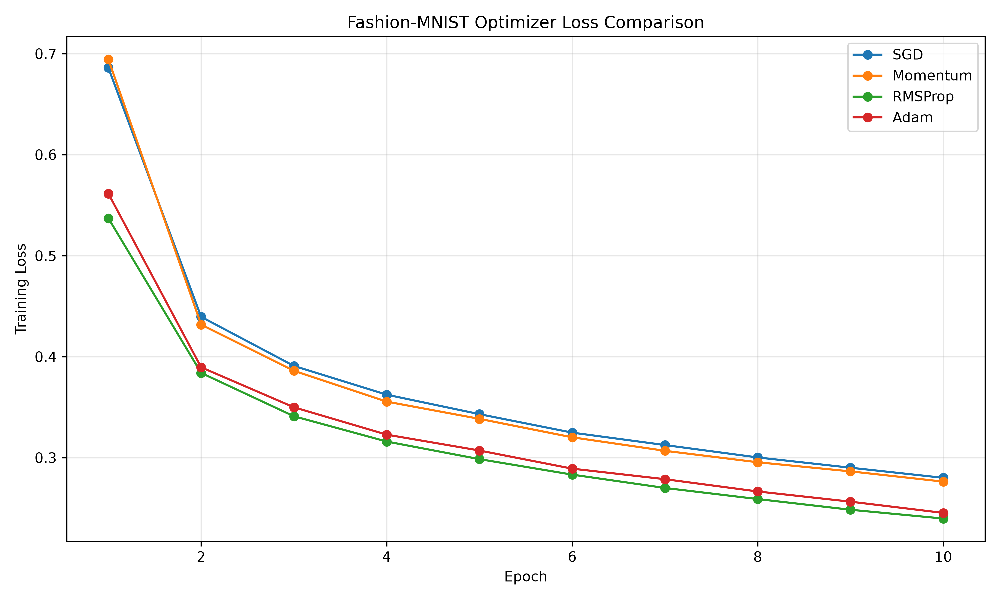
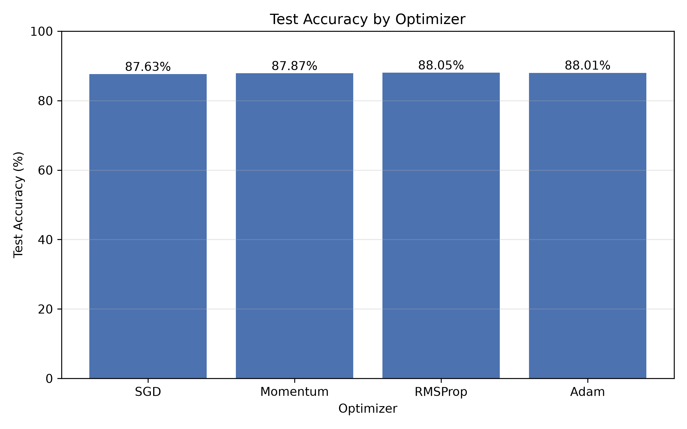
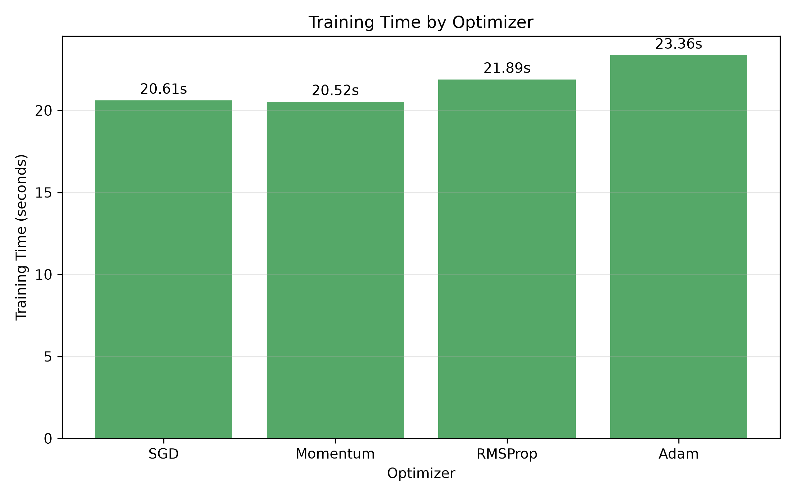

# Fashion-MNIST 优化器比较实验

一个简洁的 PyTorch 实验项目，在 Fashion-MNIST 数据集上比较四种常见优化器（SGD、Momentum、RMSProp、Adam）的性能差异。

## 简介

本项目的目标是在相同的模型结构和训练设置下，观察不同优化器对训练效果的影响。通过固定随机种子、让每个优化器从完全相同的模型初始化出发，保证比较的公平性。

## 实验目标

- 在 Fashion-MNIST 上训练一个多层感知机（MLP）分类模型
- 比较 SGD、Momentum、RMSProp、Adam 四种优化器的收敛效果
- 记录并对比各优化器的测试准确率、训练时间与最终 loss

## 数据集

[Fashion-MNIST](https://github.com/zalandoresearch/fashion-mnist) 是一个服装图像分类数据集，包含 10 个类别（T恤、裤子、鞋子、包等），共 70,000 张 28×28 的灰度图像（训练集 60,000 张，测试集 10,000 张），常被用作 MNIST 的替代基准。

## 模型结构

三层全连接网络（MLP）：

```
输入 (28×28 = 784)
  → Linear(784, 128) → ReLU
  → Linear(128, 64)  → ReLU
  → Linear(64, 10)
```

## 比较的优化器

| 优化器 | 学习率 | 说明 |
|--------|--------|------|
| SGD | 0.1 | 普通随机梯度下降 |
| Momentum | 0.01 | 带动量（momentum=0.9）的 SGD |
| RMSProp | 0.001 | 自适应学习率 |
| Adam | 0.001 | 结合动量与自适应学习率 |

## 实验设置

- 框架：PyTorch
- 损失函数：交叉熵损失（CrossEntropyLoss）
- 训练轮数：10 个 epoch
- 批大小：64
- 随机种子：42（固定，保证可复现）
- 每个优化器使用各自调优后的学习率，且都从相同模型初始化开始训练

## 最终结果

| 优化器 | 学习率 | 准确率 | 训练时间(秒) | 最终 Loss |
|--------|--------|--------|--------------|-----------|
| SGD | 0.1 | 87.63% | 19.11 | 0.2800 |
| Momentum | 0.01 | 87.87% | 19.53 | 0.2763 |
| RMSProp | 0.001 | 88.05% | 21.61 | 0.2397 |
| Adam | 0.001 | 88.01% | 26.40 | 0.2453 |

## 结果图

### 训练 Loss 曲线



### 测试准确率



### 训练时间



## 项目结构

```
optimizer-homework/
├── main.py                 # 主实验脚本
├── requirements.txt        # 依赖列表
├── README.md
├── .gitignore
├── data/                   # Fashion-MNIST 数据集（不提交）
├── results/
│   ├── experiment2_tuned_lr.csv   # 主实验结果表
│   ├── experiment1_same_lr.csv    # 第一轮（相同学习率）结果
│   └── experiment_summary.md      # 实验总结
└── figures/
    ├── experiment2_tuned_lr_loss.png   # Loss 曲线
    ├── accuracy_comparison.png         # 准确率柱状图
    ├── training_time_comparison.png    # 训练时间柱状图
    └── experiment1_same_lr_loss.png    # 第一轮 Loss 曲线
```

## 环境安装

```bash
# 建议使用虚拟环境
python -m venv .venv
# Windows
.venv\Scripts\activate
# Linux / macOS
source .venv/bin/activate

pip install -r requirements.txt
```

## 运行方式

```bash
python main.py
```

运行完成后，结果表和图片会自动保存到 `results/` 与 `figures/` 目录。

## 实验结论

- RMSProp 准确率最高（88.05%），Adam 非常接近（88.01%）
- SGD 在调大学习率后性能显著提升，说明其对学习率敏感
- Adam 耗时最长，因为内部维护了更多自适应参数状态
- 不同优化器对学习率的敏感程度不同

> 以上为单次实验结果，如需更稳健的结论，建议多次实验并报告均值与标准差。

## 后续可改进方向

- 多次实验取平均，报告均值与标准差，减少随机波动
- 尝试 CNN 等更强模型，观察优化器差异是否依然明显
- 引入学习率调度器（如余弦退火、StepLR）
- 增加更多优化器（如 AdamW、NAdam、AdaGrad）
- 记录训练曲线收敛到固定 loss 所需的 epoch 数
