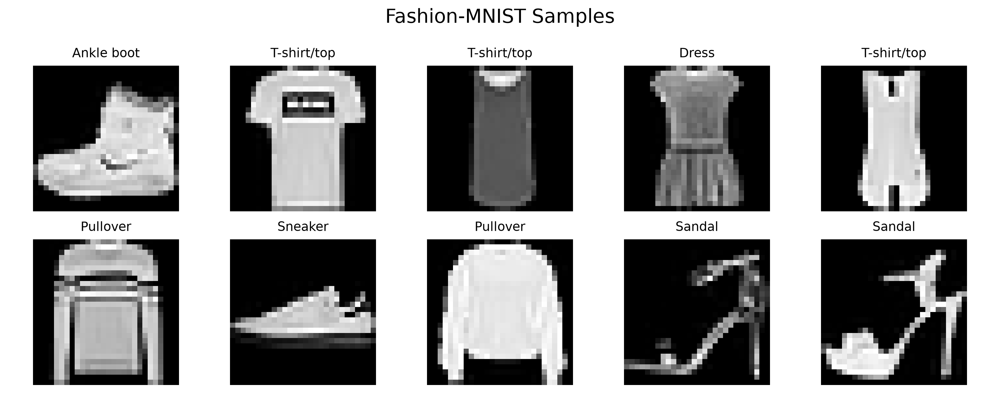

# 机器学习优化器比较实验报告

## 1. 实验题目

基于 Fashion-MNIST 的 MLP 图像分类及优化器性能比较

## 2. 实验目的

本次实验旨在通过一个完整的图像分类任务，达到以下几个目标：

1. 熟悉 PyTorch 的基本训练流程，包括数据加载、模型定义、训练循环、评估与结果保存。
2. 完成 Fashion-MNIST 数据集的图像分类任务。
3. 理解常见优化器（SGD、Momentum、RMSProp、Adam）的基本原理与作用。
4. 在统一条件下比较四种优化器的表现，从损失、准确率、收敛速度、训练时间等方面进行分析。
5. 理解学习率等超参数对优化器性能的重要影响。

## 3. 实验任务与数据集

本实验采用 **Fashion-MNIST** 数据集，这是一个经典的服装图像分类数据集，常被用作手写数字数据集 MNIST 的替代基准。其基本情况如下：

- 训练集：60,000 张图像
- 测试集：10,000 张图像
- 图像尺寸：28×28 的灰度图像（单通道）
- 类别数：10 个服饰类别

10 个类别分别为：

| 编号 | 类别（英文） | 类别（中文） |
|------|--------------|--------------|
| 0 | T-shirt/top | T 恤 / 上衣 |
| 1 | Trouser | 裤子 |
| 2 | Pullover | 套头衫 |
| 3 | Dress | 连衣裙 |
| 4 | Coat | 外套 |
| 5 | Sandal | 凉鞋 |
| 6 | Shirt | 衬衫 |
| 7 | Sneaker | 运动鞋 |
| 8 | Bag | 包 |
| 9 | Ankle boot | 短靴 |

Fashion-MNIST 之所以适合本次实验，主要因为：它比 MNIST 略具挑战性（服装图像之间的相似度更高），但数据规模适中、结构简单，普通 CPU 也能在较短时间内完成训练，非常适合用来观察不同优化器在训练过程中的差异。

下图为本项目实际使用的部分训练样本：



## 4. 实验环境

本次实验的软硬件环境如下（版本号均取自项目实际运行环境）：

| 项目 | 配置 |
|------|------|
| 操作系统 | Windows |
| 计算设备 | CPU |
| Python | 3.12.14 |
| PyTorch | 2.14.1（CPU 版） |
| torchvision | 0.29.1（CPU 版） |
| NumPy | 2.5.4 |
| Pandas | 3.0.6 |
| Matplotlib | 3.11.2 |

## 5. 模型设计

本实验采用一个简单的多层感知机（Multi-Layer Perceptron，MLP）作为分类模型。

输入为 28×28 的灰度图像，首先通过 `Flatten` 层展平为 784 维向量，然后依次经过三层全连接网络：

```
输入图像 (28×28)
    ↓ Flatten 展平
784 维向量
    ↓ Linear(784, 128)
ReLU 激活
    ↓ Linear(128, 64)
ReLU 激活
    ↓ Linear(64, 10)
输出 10 个类别的得分
```

**为什么输出维度是 10？** 因为 Fashion-MNIST 共有 10 个服饰类别，模型最后一层需要为每个类别输出一个得分，再配合交叉熵损失函数（内部包含 Softmax）完成分类。

**损失函数**：交叉熵损失（`CrossEntropyLoss`），这是多分类任务中最常用的损失函数之一。

**其他关键超参数**：

| 参数 | 取值 |
|------|------|
| 批大小（Batch Size） | 64 |
| 训练轮数（Epoch） | 10 |
| 随机种子 | 42（固定，保证可复现） |

## 6. 优化器介绍

本实验比较以下四种优化器：

### SGD（随机梯度下降）

SGD 是最基础的优化算法。它在每个训练批次上计算梯度，并沿梯度的负方向以固定学习率更新参数。其实现简单、易于理解，但对学习率比较敏感，学习率设置不当容易导致收敛缓慢或震荡。

### Momentum（动量法）

Momentum 在 SGD 的基础上引入"动量"概念，即在更新参数时，不仅考虑当前梯度，还累积历史梯度方向，从而减弱震荡、加速收敛。本实验中动量系数设为 0.9。

### RMSProp

RMSProp 是一种自适应学习率算法，它利用梯度平方的移动平均来对每个参数的学习率进行缩放，使参数更新更加平稳，对不同尺度的梯度具有更好的适应性。

### Adam

Adam 结合了 Momentum 与 RMSProp 的思想：既利用一阶矩（梯度均值）估计动量，又利用二阶矩（梯度平方均值）自适应调整每个参数的学习率。它是目前最常用、通常表现最稳健的优化器之一。

## 7. 实验设计

为了更全面地理解优化器行为，本次实验分两个阶段进行。

### 7.1 初始实验：统一学习率

在第一阶段，我们让四个优化器**使用完全相同的学习率** `lr = 0.001`，在相同条件下各训练 10 个 epoch，目的是观察"在相同学习率下，不同优化器的表现差异"。该阶段结果如下（数据来自 `results/experiment1_same_lr.csv`）：

| 优化器 | 学习率 | 准确率 | 训练时间(秒) | 最终 Loss |
|--------|--------|--------|--------------|-----------|
| SGD | 0.001 | 61.73% | 9.44 | 1.4773 |
| Momentum | 0.001 | 81.84% | 9.53 | 0.4994 |
| RMSProp | 0.001 | 86.99% | 10.16 | 0.3040 |
| Adam | 0.001 | 87.50% | 10.70 | 0.3059 |

从该结果可以明显看出：在 `lr = 0.001` 的条件下，**SGD 收敛明显较慢**，最终准确率仅有 61.73%，远低于另外三种优化器。

但需要特别强调：**不能因此直接得出"SGD 不如 Adam"的结论**。SGD 的"落后"很大程度上是因为 0.001 这个学习率对 SGD 而言过小。SGD 对学习率高度敏感，合适的学习率下它同样能取得良好的结果（这一点将在主实验中得到印证）。

### 7.2 主实验：调整学习率

在第二阶段（主实验）中，我们根据各优化器的特性，为它们分别设置了更合理的学习率：

| 优化器 | 学习率 |
|--------|--------|
| SGD | 0.1 |
| Momentum | 0.01 |
| RMSProp | 0.001 |
| Adam | 0.001 |

其余设置保持一致：

- 训练轮数：10 个 epoch
- 批大小：64
- 固定随机种子为 42，并保证每个优化器都从**相同的模型初始化**开始训练

这样做的原因是：SGD 和 Momentum 这类非自适应优化器通常需要较大的学习率才能有效收敛，而 RMSProp、Adam 这类自适应优化器在小学习率下即可表现良好。因此，"为每个优化器分别设置合理学习率"比"简单统一学习率"更符合实际使用习惯，也能更公平地展现各优化器在其合理配置下的能力。

同时需要明确说明：这**仍然不是严格意义上的大规模超参数搜索**，只是课程作业中基于经验做出的合理参数设置。因此后文的分析均基于"本次实验"这一前提，不夸大"公平比较"。

## 8. 主实验结果

主实验结果如下表所示（数据来自 `results/experiment2_tuned_lr.csv`）：

| 优化器 | 学习率 | 准确率 | 训练时间(秒) | 最终 Loss |
|--------|--------|--------|--------------|-----------|
| SGD | 0.1 | 87.63% | 20.61 | 0.2800 |
| Momentum | 0.01 | 87.87% | 20.52 | 0.2763 |
| RMSProp | 0.001 | 88.05% | 21.89 | 0.2397 |
| Adam | 0.001 | 88.01% | 23.36 | 0.2453 |

### 训练 Loss 曲线

下图展示了四种优化器在 10 个 epoch 内的训练 Loss 变化：


### 测试准确率对比


### 训练时间对比


## 9. 结果分析

下面从多个角度对主实验结果进行分析。

**1. 收敛速度**

从 Loss 曲线可以看出，RMSProp 和 Adam 在训练初期（前 1～2 个 epoch）Loss 下降较快，体现出自适应优化器较快的收敛能力；而 SGD 和 Momentum 的 Loss 下降相对平缓，需要更多轮数才能达到相近水平。

**2. 最终 Loss**

RMSProp 的最终 Loss 最低（0.2397），Adam 次之（0.2453）。这与自适应学习率算法更稳定、更精确的更新方式有关。

**3. 最终准确率**

RMSProp 取得最高测试准确率 88.05%，Adam 为 88.01%，二者**非常接近**，仅相差 0.04 个百分点。因此不能说"RMSProp 显著优于 Adam"，两者在本次实验中基本处于同一水平。

**4. SGD 的表现变化**

对比两个阶段的结果可以发现，SGD 在 `lr=0.001` 时准确率仅 61.73%，而将学习率提高到 0.1 后，准确率跃升至 87.63%，提升幅度超过 25 个百分点。这充分说明**学习率对 SGD 的影响非常明显**——非自适应优化器对学习率的敏感度远高于自适应优化器。

**5. Momentum 的表现**

在主实验中，Momentum（87.87%）优于普通 SGD（87.63%），说明加入动量后有助于改善训练表现、加速收敛。这一点在两个阶段的结果中都能得到印证（初始实验中 Momentum 为 81.84%，同样明显高于 SGD 的 61.73%）。

**6. 训练时间**

在本次 CPU 单次实验中，Adam 耗时最长（约 23.36 秒），主要因为它需要额外维护一阶矩和二阶矩等自适应状态，计算开销更大。但需要注明：**训练时间受机器性能、系统负载、随机因素等影响较大**，本次的时间差异不能推广为普遍结论。

**7. 整体认识**

通过本次实验可以认识到：**优化器并不存在脱离超参数和任务场景的绝对优劣**。在实际选择优化器时，应综合考虑收敛速度、最终准确率、超参数敏感性以及训练成本等多方面因素。

## 10. 实验结论

基于本次实验，可以得出以下结论：

1. 四种优化器均能完成 Fashion-MNIST 图像分类任务。
2. 在本次单次主实验中，RMSProp 取得了最高测试准确率 88.05%。
3. Adam 与 RMSProp 效果非常接近（相差 0.04 个百分点），且同样具有较快的收敛能力。
4. SGD 对学习率较为敏感，在将学习率从 0.001 调整到 0.1 后，性能明显提升。
5. 优化器的性能与学习率等超参数密切相关，不同优化器对学习率的敏感程度存在差异。

> 以上结论均基于**本次实验**、**本次单次实验**的数据，不代表任何优化器具有普遍性的绝对优势。

## 11. 实验不足与改进方向

本次实验仍存在一些可以改进的地方：

- 当前仅进行了单次随机种子实验，结果可能受随机因素影响；可进行多次重复实验并计算均值与标准差。
- 学习率仅基于经验设定，尚未进行系统的网格搜索或学习率调度。
- 仅使用了简单的 MLP 模型，尚未尝试 CNN 等更强模型。
- 尚未比较 AdamW、AdaGrad、NAdam 等更多优化器。
- 训练在 CPU 上进行，若使用 GPU 可以进一步缩短时间。
- 训练轮数（10 epoch）相对有限，可适当增加以观察更长期的收敛趋势。

以上改进方向为后续工作的参考，并不影响本次实验结论的有效性。

## 12. 项目文件说明

| 文件/目录 | 说明 |
|-----------|------|
| `main.py` | 主实验脚本，包含数据加载、模型定义、训练与评估、可视化与结果保存 |
| `requirements.txt` | 项目依赖列表 |
| `results/` | 实验结果目录，包含两轮实验的 CSV 结果表与实验总结 |
| `figures/` | 结果图表目录，包含 Loss 曲线、柱状图与数据样本图 |
| `report/` | 课程实验报告目录 |

---

*本报告所有实验数据均来自项目仓库中的真实运行结果，未做任何伪造或篡改。*
